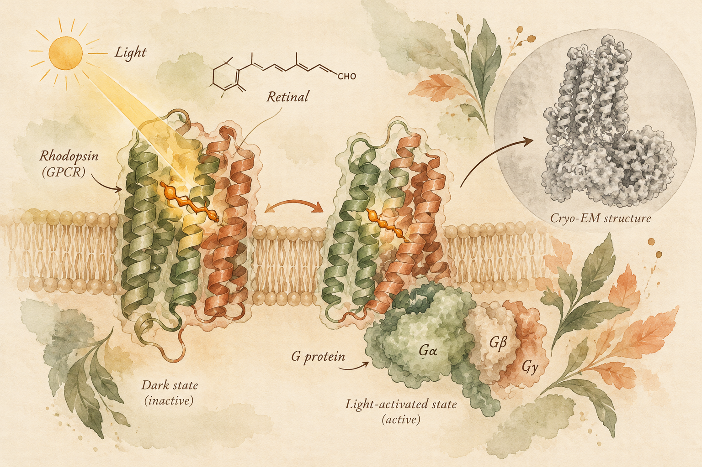

## 01 / A Little About Me

{: .profile-photo }

I'm Daniel Geller, a PhD student at the
**Weizmann Institute of Science**.

I earned my B.Sc. in **Biochemistry and Food Science**
from the Hebrew University's Faculty of Agriculture.

Before joining Weizmann, I worked at **Aleph Farms**,
a company pioneering cultivated meat.

I completed my M.Sc. in
[Prof. Moran Shalev-Benami's lab](https://www.weizmann.ac.il/csb/shalev-benami/),
where I'm now continuing my research as a PhD student.

---

## 02 / My Research

### Shedding Light on Light-Sensitive Proteins

Ever wondered how proteins can sense light and turn it
into a biological signal?

That's exactly what I study!

My research focuses on **animal rhodopsins**,
light-sensitive proteins belonging to the GPCR family.

Using **cryo-electron microscopy (cryo-EM)**,
biochemistry, and functional experiments,
I investigate how these proteins respond to light,
change their structure, and interact with G proteins.

My goal is to understand how nature transforms light
into cellular signals and explore their potential
as tools for controlling biological processes using light.

---

## 03 / Beyond the Lab

### Hiking Adventures

I love exploring nature, especially hiking along
the **Israel National Trail (Shvil Israel)**.

### Around the World

Traveling is one of my greatest passions!

**Japan** holds a special place in my heart,
and I love discovering new cultures, landscapes,
and hidden corners of the world.

---

## 04 / Through My Lens

Photography is my way of capturing the places,
people, and moments that make every adventure memorable.

---

## 05 / Contact Me

Have a question about my research, want to collaborate,
or just feel like saying hello?

I'd love to hear from you!

**Email:** [daniel.zhornist@weizmann.ac.il](mailto:daniel.zhornist@weizmann.ac.il)
